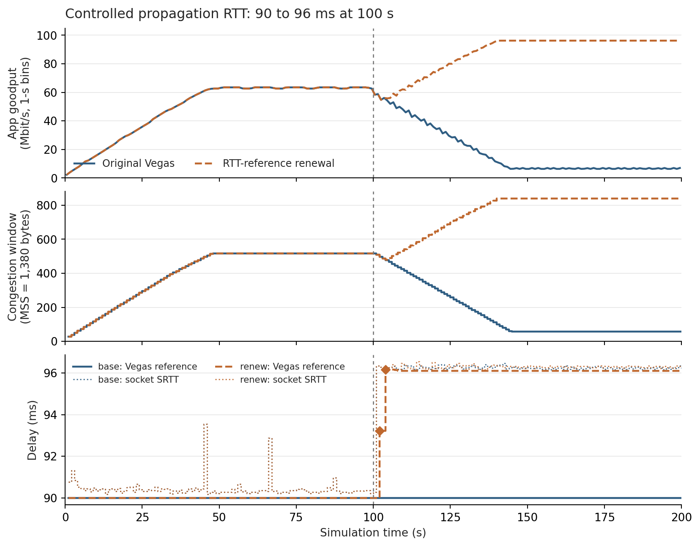
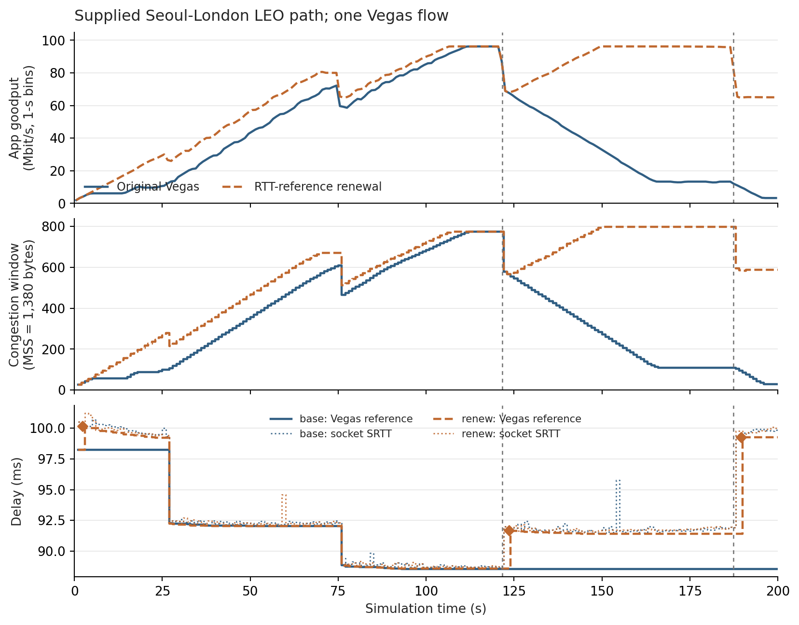
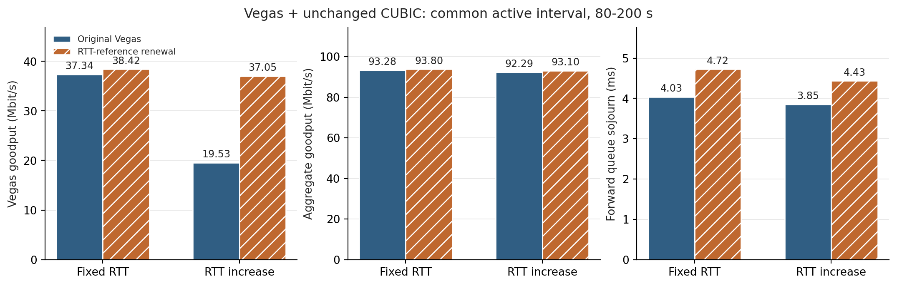

# Updating Vegas's RTT reference under LEO path changes

This English research brief organizes the **first renewal implementation (v1)** into a bounded course case study. It is not the final IEEE report, a team-approved topic, or a submission archive. The supplementary v2 algorithm and the earlier CUBIC/SACK improvements are not included as main improvements. Read the [experiment record](../../../docs/experiments/20261010-vegas-rtt-renewal.md) and [literature-based scope](../../../docs/research/20261010-vegas-scope-and-alternatives.md).

## Introduction and problem statement

Vegas estimates congestion by comparing its current RTT with a lifetime minimum reference. When a LEO route acquires a longer propagation delay, an old reference can make available capacity appear congested. Vegas then decreases its congestion window even without an observed queue-drop event. We investigate this mechanism in the course ns-3.48 environment rather than assume that every low-throughput period is caused by a route switch.

Vegas is selected because the course includes this implementation and its explicit reference makes the mechanism directly observable. It is a historical delay-based controller, not a claim about the prevalence or competitiveness of Vegas in current deployments. Modern satellite work on refreshing transport estimates motivates the broader issue, but our results do not establish a corresponding defect or fix in BBR or CUBIC.

The course port supplies **socket SRTT** to Vegas. Its per-cycle minimum and lifetime reference are therefore derived from smoothed observations; they are not direct propagation RTT or measured queue delay. All comparisons preserve this input convention.

## Proposed idea and prior work

The implementation stores the minimum SRTT of 20 consecutive valid congestion-avoidance cycles. If that minimum is at least 1 ms above the existing reference, it replaces the reference. It retains the original downward-minimum update, startup, recovery and normal ±1 MSS decisions. No explicit route report, network telemetry or direct window boost is introduced. Invalid cycles clear the history, and the feature is disabled by default.

Recent-minimum reference replacement is an established idea: La, Walrand and Anantharam's [Issues in TCP Vegas, §3–4](https://www2.eecs.berkeley.edu/Pubs/TechRpts/1999/ERL-99-3.pdf) discusses both rerouting and persistent congestion. Our CA-cycle/SRTT implementation differs from its packet blocks, bootstrap estimator, consecutive-block tests and window rescaling. We claim a course-environment adaptation and measured application range, not invention of the underlying principle.

The assumption is that a sustained elevated minimum can be a useful reference when propagation changes. **It does not identify the cause of that elevation.** Persistent competitor queues violate the interpretation. Endpoint implementation costs include bounded history, delayed adaptation and possible incorporation of queue delay into the reference. The recorded histories around the principal renewals last approximately 1.7–1.9 seconds, not a fixed 20-second timer.

The 20-cycle/1-ms settings were declared before execution. They are exploratory settings, not optimal values, a measured noise bound, or the original paper's settings. Their engineering intent is persistent evidence with bounded storage and avoidance of very small updates. Broader parameter robustness is unverified.

## Experiment setup

- Official `ghcr.io/yeonjong21/cs30401-lab1:2026f-v1`, ns-3.48 and supplied Hypatia modules.
- Single Seoul-London LEO bulk flow, 200 s, 100 Mbit/s links, 100-packet queues, MSS 1,380 bytes, seed 123456789. Instant routing changes; no added handover outage, random radio loss or variable link capacity.
- Controlled single-bottleneck scenarios: fixed 90-ms propagation RTT; or 90→96 ms at 100 s; each also tested with an unchanged CUBIC flow joining at 80 s. These controls isolate one mechanism, not a replacement for the satellite topology.
- Original Vegas and v1 use matched input settings. The sole policy switch is renewal. Source, patch, image, commands, actual settings, binary and shared-library identities are retained in the existing evidence.

The rate, queue and delay-step settings are the declared exploratory setup. They are not measurements of a deployed Starlink bottleneck. The queue cost tests compare the two flows over **80–200 s**, a common 120-s active interval, rather than comparing the CUBIC flow's 120-s lifetime with Vegas's 200-s lifetime.

## Evaluation: benefits

Application goodput is receiver-delivered payload bytes × 8 / duration / 10^6. These are deterministic measurements, without statistical confidence intervals.

| Single-flow scenario, full 200 s | Original Vegas (Mbit/s) | v1 (Mbit/s) |
|---|---:|---:|
| Fixed propagation RTT | 56.2704 | 56.2704 |
| Propagation RTT increase | 33.8117 | 68.3846 |
| Supplied LEO path | 41.5113 | 69.3432 |

In the controlled increase, both policies deliver exactly **616,597,800 bytes before 100 s**. Over [100,200), goodput changes from **18.2956 to 87.4413 Mbit/s**. Together with the internal decision trace and unchanged fixed-path result, this supports the reference-update mechanism rather than an unrelated startup change in the controlled case.

The LEO policy adds **695,797,380 application bytes** over 200 s, a **67.0465%** gain. There are renewals at 2.2958, 123.5877 and 189.5489 s. The first is an early CA renewal, not evidence of a late route event. Exact temporal accounting from the existing raw receiver logs is:

| LEO interval | Original (Mbit/s) | v1 (Mbit/s) | Additional application bytes |
|---|---:|---:|---:|
| [0,121.6), 121.6 s | 50.3612 | 58.7259 | 127,143,540 |
| [121.6,187.4), 65.8 s | 31.9184 | 89.7312 | 475,510,740 |
| [187.4,200), 12.6 s | 6.1999 | 65.3384 | 93,143,100 |

The first interval accounts for **18.27%** of added bytes. This is accounting over time, not proof that 18.27% was caused by startup or that the remainder was caused solely by two route events. The 67% statement describes the **overall policy**, including the early renewal.

For these plots, app delivery is summed in [start,end) one-second bins. State and RTT traces use the last value at or before each one-second boundary; no interpolation or missing raw rows are fabricated. Diamonds show exact renewal events from the unsampled evidence. Vertical guides show the controlled step or the two selected LEO propagation-increase events. They do not assert that these are the only changes on the LEO route. Socket SRTT is labelled separately from the reference.

## Evaluation: costs and unsuccessful conditions

| Vegas + CUBIC, 80–200 s | Original | v1 |
|---|---:|---:|
| Fixed: Vegas / CUBIC goodput (Mbit/s) | 37.3433 / 55.9401 | 38.4198 / 55.3829 |
| Fixed: aggregate (Mbit/s) / Jain | 93.2834 / 0.9618 | 93.8027 / 0.9683 |
| Fixed: forward mean device-queue sojourn (ms) | 4.0348 | 4.7240 |
| Fixed: TrafficControlLayer TcDrop count | 204 | 186 |
| RTT increase: Vegas / CUBIC goodput (Mbit/s) | 19.5320 / 72.7560 | 37.0452 / 56.0532 |
| RTT increase: aggregate (Mbit/s) / Jain | 92.2880 / 0.7504 | 93.0984 / 0.9600 |
| RTT increase: forward mean device-queue sojourn (ms) | 3.8479 | 4.4340 |
| RTT increase: TrafficControlLayer TcDrop count | 189 | 199 |

The reference is raised 28 times even in the **fixed-propagation** competition test. Its maximum is 99.4529 ms despite a 90-ms propagation RTT. This is a counterexample to a route-versus-congestion classifier. In the delay-increase competition, the Vegas share improves substantially, but most of that improvement is a redistribution from CUBIC; the aggregate gain is about **0.88%**. Both conditions show higher common-window mean queue sojourn, while drop counts move in different directions.

The mean queue metric is packet-weighted forward device-queue waiting time, measured directly in the controlled topology. It is not whole-route LEO delay. Results are also window dependent: the last-20-s fixed case improves queue delay, while the last-20-s step case worsens it. See the full existing table for those windows. Device QueueDrop and TrafficControlLayer TcDrop are different layers; one cannot infer no congestion drops from QueueDrop=0.

In LEO, official retransmission rows increase **41→71** and recovery entries **2→4**, with no modeled drops observed by the installed coverage. These raw counts accompany different delivered byte totals and do not identify every retransmission's cause. The idea is not a retransmission-reduction result. Direct LEO queue sojourn is unavailable.

## Conclusion and work remaining

Refreshing a stale reference yields a substantial, reproduced delivery gain in the supplied single-flow LEO case and its delay-increase control. It also absorbs persistent competitor queues. The supported conclusion is a benefit with a clear information limitation and coexistence cost, not a universally superior TCP or a deployed Starlink result.

The next literature-based comparator is **Vegas-A-inspired threshold adaptation**, because its existing work directly addresses rerouting/LEO conditions using endpoint CA state. It has not been implemented or measured here. The [scope note](../../../docs/research/20261010-vegas-scope-and-alternatives.md) records why simple aging, unmodified queue-drain probing and full outage-aware protocol ports are not immediate alternatives.

Before final submission: agree the team scope and names, produce the required English IEEE report, finalize parameter bases and command-to-figure/table mapping, and verify a reproducible archive **without assuming a Git checkout**. Existing fresh-clone replay proves deterministic repeatability, not that the final ZIP workflow works. No new simulations were performed for this brief or its figures.
