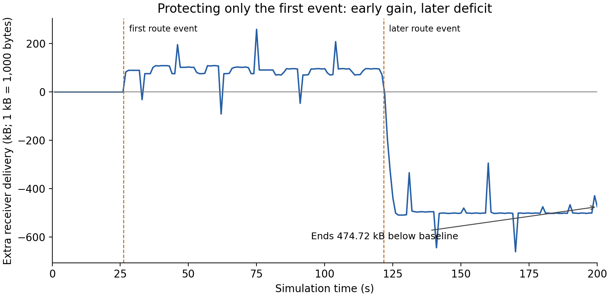
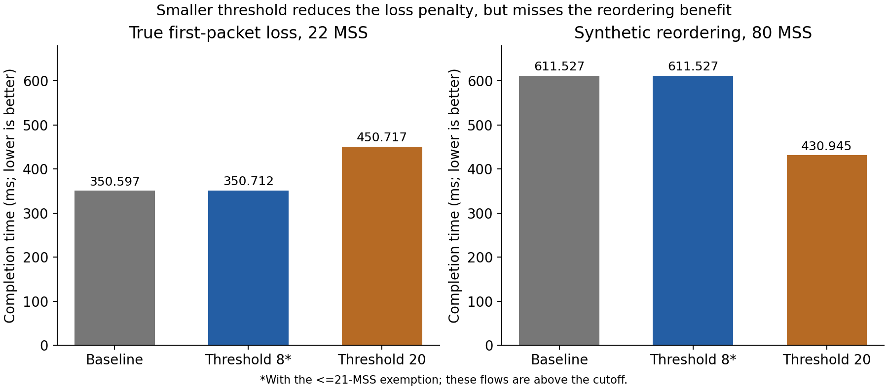

# CUBIC follow-up: why early protection can hurt later

**Status:** completed exploratory investigation on 2026-10-10, [PR #10](https://github.com/Jeongmin07/CS30401-Lab1/pull/10). Owner: Jeongmin07. Branch: `experiment/cubic-q75-followup`, based on merged `main` commit `b60e8e0`. This extends the [75-packet experiment](20261010-cubic-q75.md) with Seongchan's canonical version-6 patch.

## Start here

- **The problem exists in this simulator:** route changes reorder packets. TCP sometimes retransmits and reduces its sending window even though the original packet has already reached the receiver.
- **Protecting the first event is insufficient:** it helps around 26.2 s but changes later congestion cycles. The original protected run ends 474,720 bytes behind baseline.
- **Protecting the later event recovers that deficit:** protection around both 26.2 s and 121.6 s finishes 6,900 bytes ahead at queue 75. This is only **0.0029%**, weak evidence for an overall throughput improvement.
- **Threshold 8 is a restricted candidate:** it matches threshold 20's LEO delivery in three tested conditions and nearly eliminates its measured 22-MSS real-loss penalty. It fails to improve the synthetic reordering example.
- **Results reproduced:** 29 new configurations plus the two original comparison cases were replayed after a fresh source build. All 279 raw-file hashes and 31 full-analysis hashes match. Replays verify determinism; they are not independent statistical samples.

My assessment: use this as a study of mistaken recovery and the tradeoff between tolerating reordering and detecting actual loss. It supports a conditional demonstration with known event times. It does not establish a general, deployable TCP rule or a meaningful overall throughput gain.

## Conditions and case groups

All LEO cases use Seoul–London, sender 1584, receiver 1585, course CUBIC/SACK/PRR, 10-Mbit/s links, 200 s, one 100-GB bulk flow, seed 123456789, and 100-ms route updates. Controls use queue 75, queue 50, and a one-second flow-start shift at queue 75, each with its own unprotected baseline.

The intervention temporarily changes the loss threshold from 3. Requested intervals are 26.1–26.5 s and **121.5–121.9 s**. The latter replaces the ineffective 74.9–75.3 s interval in the earlier check. The patch can defer restoration; actual protection intervals are in each `summary.json`. Event times are supplied in advance: this is an oracle experiment.

The initial plan declared four queue-75 controls, six changed-condition controls, and eleven synthetic cases. After threshold 4 failed to remove the studied recovery, eight exploratory refinements tested thresholds 8 and 9 with the existing <=21-MSS exemption. These refinements were chosen after seeing earlier results. Threshold 8 is the smallest successful **tested** value, not a proven minimum.

Synthetic controls use 100 Mbit/s, queue 2,000, one flow, and a 4-s simulation. MSS = 1,380 bytes:

- Actual loss: discard the first data transmission at or after 0.15 s; send 20 or 22 MSS with unchanged 50-ms one-way delay.
- Reordering: send 80 MSS; reduce one-way delay from 50 to 45 ms at 0.201 s. No network drops are recorded.
- Protection requests 0–0.5 s. The exemption retains threshold 3 when the application's known total size is <=21 MSS; it requires that size information.

## Where the original deficit accumulates

The [receiver timeline](assets/cubic-followup-20261010/original-audit/delivery_timeline.csv) sums ordered, unique application bytes over intervals `[start,end)`. Positive differences mean protection has delivered more by that time.



| Interval, s | Protected minus baseline, bytes |
| --- | ---: |
| 0–25.7 | 0 |
| 25.7–28.2 | +89,700 |
| 28.2–120 | +5,520 |
| 120–130 | **−603,060** |
| 130–160 | +213,900 |
| 160–170 | **−367,080** |
| 170–200 | +186,300 |
| Entire 200 s | **−474,720** |

**Observed:** the protected run is ahead by 95,220 bytes at 120 s. Most of that lead disappears around the 121.6-s route change, whose propagation RTT increases by about 3.06 ms. A total RTT decrease is not necessary for forward-path reordering.

In the protected run, sequence 143847061 is accepted at 121.623085525 s. The sender enters recovery and retransmits it at 121.667779911 s, about 44.694 ms later. The original transmission tag and same-time receiver application delivery are identified; there is no matching recorded network drop. [Packet evidence](assets/cubic-followup-20261010/cases/q75-guard-first/event121_gaps.json) preserves the join. The baseline also has a candidate unnecessary recovery at this event.

Neither run has recorded network drops over 120–130 s, but earlier drop bursts and recovery times differ. At 121.6 s, congestion windows are 180,780 bytes for baseline and 132,480 for first-event protection. At 121.9 s they are 133,860 and 96,600; at 125 s, 180,780 and 114,540. See [the checkpoints](assets/cubic-followup-20261010/original-audit/cwnd_checkpoints.csv).

**Inference:** the first intervention shifts later congestion/drop cycles. A later mistaken recovery then reduces an already smaller window, causing poorer delivery while it regrows. The traces and later-window control support this explanation, but do not isolate every queue state or explain every subsequent byte difference. The canonical analyzer's drop-coverage and receiver-acceptance limitations still apply.

## LEO results

Goodput = receiver application bytes × 8 / 200 s. Event counts use fixed 2.5-s windows, not just the requested protection interval.

| Queue-75 setting | Goodput, Mbit/s | Difference from baseline, bytes | Recovery entries near 26.2 / 121.6 s |
| --- | ---: | ---: | --- |
| Baseline | 9.5105184 | — | 1 / 1 |
| Threshold 20, first only | 9.4915296 | −474,720 | 0 / 1 |
| Threshold 20, later only | 9.5116776 | +28,980 | 1 / 2 |
| Threshold 4, first only | 9.5100216 | −12,420 | 1 / 1 |
| Threshold 4, both | 9.5100768 | −11,040 | 1 / 1 |
| Threshold 20, both | 9.5107944 | +6,900 | 0 / 0 |
| Threshold 8 + exemption, both | 9.5107944 | +6,900 | 0 / 0 |
| Threshold 9 + exemption, both | 9.5107944 | +6,900 | 0 / 0 |

The later-only case has the highest total here but increases local counts at the later event to two recoveries and eleven retransmissions. Maximizing total delivery and eliminating the two studied recoveries are different objectives. Threshold 4 leaves both event recoveries in place.

| Condition | Baseline, Mbit/s | Threshold 8 + exemption, both events | Relative change |
| --- | ---: | ---: | ---: |
| Queue 75, start 0 s | 9.5105184 | 9.5107944 | +0.0029% |
| Queue 75, start 1 s | 9.4530552 | 9.4642608 | +0.1185% |
| Queue 50, start 0 s | 9.1782696 | 9.1852800 | +0.0764% |

Threshold 20 has the same displayed total delivery and event counts as threshold 8 in these conditions. Their traces need not be identical. All three use the same path and event schedule.

## Actual loss: the cost of waiting longer

Completion time is the last receiver application delivery time. These flows start at zero and deliver their complete intended sizes. Their 4-s average goodput hides the delay because every transfer finishes within 4 s.

| Actual first-segment loss | Baseline / threshold 4 | Threshold 20 | Threshold 20 + exemption |
| --- | ---: | ---: | ---: |
| 20-MSS transfer | 0.251509920 s | **1.150124001 s** | 0.251509920 s |
| 22-MSS transfer | 0.350597120 s | **0.450716800 s** | **0.450716800 s** |

For the 22-MSS transfer, threshold 8 plus exemption finishes at **0.350711840 s**, a 0.114720-ms penalty. Threshold 9 finishes at 0.350826560 s, a 0.229440-ms penalty. The exemption does not apply to this size. Threshold 20's penalty is 100.119680 ms.

The 80-MSS synthetic reordering case finishes at 0.611527200 s for baseline, threshold 4, and thresholds 8/9 plus exemption. Threshold 20 finishes at 0.430944960 s and removes eight retransmission rows. Lowering the threshold sacrifices this benefit.



## File map and shared raw data

| Need | Location |
| --- | --- |
| All measured conditions | [`assets/cubic-followup-20261010/results.csv`](assets/cubic-followup-20261010/results.csv) |
| Exact settings and compact summaries | `assets/cubic-followup-20261010/cases/<case>/` |
| Delivery bins, drops/congestion events, window checkpoints | `assets/cubic-followup-20261010/original-audit/` |
| Commands and wall times | `followup-*-execution.json`, `refinement-execution.json`, `replay*-execution.json` in that assets folder |
| Source fingerprints and fresh replay verdict | [`raw_hashes.json`](assets/cubic-followup-20261010/raw_hashes.json), [`reproduction.json`](assets/cubic-followup-20261010/reproduction.json) |
| Reusable runner, exporter, verifier, archive and plots | [`code/cubic-followup/`](../../code/cubic-followup/) |
| Raw traces and full analyses for all 31 cases | [GitHub experiment release](https://github.com/Jeongmin07/CS30401-Lab1/releases/tag/cubic-followup-20261010) |

The raw archive is `cubic-followup-20261010-raw.tar.gz`, **191,233,253 bytes**, SHA-256 `0bacafdff634835bd88180b579b89cc2e5c50d84eadfeb1b2da4bc2b6be7c3b8`. Download while signed into the private repo. It contains `<case>/logs_ns3/`, full `followup_analysis.json`, settings and manifests. Extract into an ignored local folder; the local archive copy is in `runs/`. Large logs are outside Git history. Both local study containers are retained.

## Reproduce from PowerShell

Use new container/volume names if these already exist. From the repository root:

```powershell
$repoRoot = (Resolve-Path .).Path
$image = 'ghcr.io/yeonjong21/cs30401-lab1@sha256:3cb4877c73b4ae5e3542c1567b6761a8913056dd429d8a18f7c40aeeb399b3b4'
docker run -d --name cubic-followup-replay --mount "type=bind,source=$repoRoot,target=/work" --mount 'type=volume,source=cubic-followup-replay-ns3,target=/home/ubuntu/ns-3.48' $image sleep infinity
docker exec -w /home/ubuntu/ns-3.48 cubic-followup-replay bash -lc 'git apply --check /work/code/kim-study/ns3.patch && git apply /work/code/kim-study/ns3.patch && ./ns3 build -j 2'
docker exec cubic-followup-replay python3 /work/code/cubic-followup/run_controls.py --study-code /work/code/kim-study --stage originals --workers 2 --out /tmp/originals-execution.json
docker exec cubic-followup-replay python3 /work/code/cubic-followup/run_controls.py --study-code /work/code/kim-study --stage all --workers 2 --out /tmp/controls-execution.json
docker exec cubic-followup-replay python3 /work/code/cubic-followup/export_results.py --study-code /work/code/kim-study --out /tmp/followup-evidence --workers 2
docker exec cubic-followup-replay python3 /work/code/cubic-followup/verify_replay.py --reference /work/docs/experiments/assets/cubic-followup-20261010 --replay /tmp/followup-evidence --out /tmp/reproduction.json
docker exec cubic-followup-replay python3 /work/code/cubic-followup/compare_traces.py --out /tmp/original-audit
New-Item -ItemType Directory -Force .\runs\followup-replay | Out-Null
docker cp cubic-followup-replay:/tmp/followup-evidence/. .\runs\followup-replay
docker cp cubic-followup-replay:/tmp/reproduction.json .\runs\followup-replay\reproduction.json
```

Patch SHA-256: `473dd0e23447a58bd7ce644507cf4aa24b612020ff1e6029f5bfdb22e2cd4245`. LEO binary SHA-256: `de9f678113c37a72df7e3215e876f18945c0ccecf9123f60fc8f655f9d9a6eab`. The inherited runner/analyzer are from merged `b60e8e0`. Initial controls were declared in `46e27cf`; refinements and export ran from the branch working tree before the results commit. Actual commands, settings and independent replay are recorded. The current scripts add an `originals` convenience stage; `all` still declares the same 29 new cases.

Verification used `lab1-cubic-followup-verify-20261010` with a newly created ns-3 volume, checked patch application and successful build. All 31 full-analysis hashes and 279 raw-file hashes, including drop-hook coverage, match. Numeric rates `10` and `10.0` are compared numerically; the initial string-format failure is retained separately. No simulation result was changed to pass the comparison.

## Why these runs were faster

The four new-case batches took 54.440 + 100.196 + 1.039 + 56.513 = **212.188 seconds** with two workers, excluding build, analysis, review and upload. The fresh 29-case replay took 258.599 s; the two originals took 46.018 s in an overlapping batch. These are actual wall times, not simulated durations.

The old eight exploratory runs used **100 Mbit/s**; this study uses **10 Mbit/s**, producing roughly one tenth the bulk payload volume over 200 simulated seconds. Fifteen new cases are tiny synthetic tests. Reusing a compiled binary and running independent cases concurrently also saves elapsed time. Some earlier updates only uploaded existing results. A fast commit/push is not evidence of a new simulation. The user's historical 20-minute runtime cannot be explained precisely without its settings and timing log.

## Remaining research beyond this completed PR

The next useful step is a held-out path or traffic mix, then inaccurate route-notification timing. Test whether threshold 8 still avoids mistaken recovery without delaying actual loss. Different seed labels on a deterministic workload do not automatically create independent samples.

No event detector, universal threshold, confidence interval, or Linux TCP claim is established. The course source lacks RACK-TLP, random wireless loss and modeled handover outages. The canonical patch, Seongchan's evidence and common `docs/PLAN.md` remain unchanged. This completed experiment contribution awaits review; it is not a final submission or main-branch merge.
