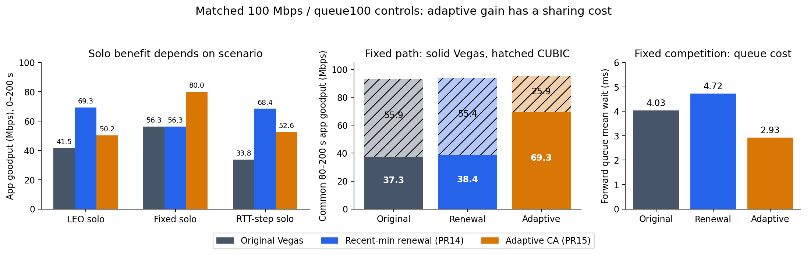

# Declared Vegas adaptive follow-up

Owner: Jeongmin07. Status: completed exploratory comparison; no merge or team decision.
Base: main b60e8e0; dependency: PR14 4a91c32 (selected source tools/v1 patch).
Scope: code/vegas-adaptive and this experiment's evidence/documentation.

Question: can published endpoint threshold adaptation recover course Vegas
goodput without upwardly replacing its propagation reference, and what queue
and competing-CUBIC costs follow? This is an empirical comparison, not a claim
that threshold adaptation identifies route changes or eliminates congestion.

See code/vegas-adaptive/README.md for predeclared mapping and initial cases.
The v1 recent-min renewal result is the existing comparator, not combined with
this candidate. The original declaration commit ad14236 contained no new results.

## Finding and choice

The adaptive candidate improves supplied LEO application goodput by **20.9394%**,
but the existing renewal candidate improves it by **67.0465%**. Adaptive CA also
changes fixed-path utilization and shifts bandwidth heavily toward Vegas when
CUBIC competes. It is a useful endpoint-only alternative, not an unqualified
replacement for PR14 v1. For a report focused on LEO stale-reference behavior,
my recommendation is to keep **PR14 v1 as the primary candidate** and this
adaptive port as a measured comparison. This is Jeongmin07's research judgment,
not an agreed PLAN update or approval to merge.

| 200s solo application goodput (Mbps) | Original Vegas | PR14 v1 renewal | Adaptive CA |
|---|---:|---:|---:|
| Supplied Seoul–London LEO | 41.5113384 | 69.3432336 | 50.2035720 |
| Fixed 90ms propagation | 56.2704384 | 56.2704384 | 79.9931904 |
| 90→96ms propagation RTT at 100s | 33.8117112 | 68.3845752 | 52.5680088 |

Fixed-path CUBIC joins at 80s. **All following numbers use the common 80–200s
interval**, including directly measured device-queue wait and time-weighted
occupancy. Jain fairness means equality of the two delivered rates; it is not
a measurement of delay or a universal definition of TCP fairness.

| Fixed competition | Original Vegas | PR14 v1 renewal | Adaptive CA |
|---|---:|---:|---:|
| Vegas app goodput, Mbps | 37.343260 | 38.419844 | 69.335432 |
| CUBIC app goodput, Mbps | 55.940140 | 55.382896 | 25.865156 |
| Aggregate app goodput, Mbps | 93.283400 | 93.802740 | 95.200588 |
| Jain fairness | 0.961775 | 0.968333 | 0.827472 |
| Forward mean queue wait, ms | 4.034803 | 4.723997 | 2.926433 |
| Forward mean occupancy, packets | 34.094763 | 40.145303 | 25.238322 |
| All-flow TcDrop rows | 204 | 186 | 196 |

Adaptive aggregate goodput rises 2.0552% relative to baseline and queue mean
wait falls 27.47%. Its foreground increase is mostly offset by the competitor's
decrease. Neither "higher Vegas goodput proves better service" nor "adaptive
always worsens queueing" is supported. LEO direct queue delay is unavailable;
the micro queue result is not a per-hop LEO queue measurement.
In fixed solo traffic, adaptive's extra utilization increases mean forward
queue wait **0.065953→0.380602ms**, with no TcDrop/retransmission rows in
either case. Its lower mixed-traffic queue wait is not a general queue claim.

## What changed

The full [ns3.patch](../../code/vegas-adaptive/ns3.patch) adds opt-in
`ns3::TcpVegas::AdaptiveThresholds` (default false) to the pinned PR14 v1
instrumented source. Only valid congestion-avoidance decisions change. Startup,
socket loss handling and recovery behavior are inherited. `RecentMinRenewal`
must remain false; the runner and simulator reject combining the policies.

The port is based on the authors' [Code3 at a pinned commit](https://github.com/skn/vegas-a/blob/a379c93fe70d5d7b16e620d0e046a69e26a1ee0e/codes/tcp-vegas.cc.code3),
read with [Srijith, Jacob and Ananda (2005), §3](https://srijith.net/publications/journals/TCP_Vegas-A_COMCOM05.pdf).
It retains course initial Alpha/Beta **2/4** and uses these as lower bounds,
where the original uses 1/3. The estimate is course cwnd-in-segments divided by
the current cycle minimum of **socket SRTT**, not measured receiver goodput or
the NS-2 original's flight/RTT estimate. It uses the existing integer Vegas
`diff`, not the original NS-2 rounded delta. Increases/decreases occur once per
valid cycle by one MSS, rather than NS-2's ACK-applied increase flag. Therefore
the result evaluates this **Vegas-A-inspired adaptation**, not the paper's
literal implementation or all Vegas-A variants.

With a previous valid estimate: above Beta decreases cwnd and thresholds;
below Alpha decreases them if Alpha exceeds its initial floor and the estimate
fell, otherwise grows cwnd when at the floor or the estimate rose. In the
Alpha–Beta band, a rising estimate increases cwnd and both thresholds; otherwise
it holds. Equality below Alpha above its floor explicitly holds, rather than
retaining an NS-2 ACK increment flag. Thresholds keep a gap of two. The first
valid cycle after enable/disable/invalid-cycle resets follows ordinary Vegas
and seeds rate history. Learned thresholds persist through recovery. A separate
`adaptive_state.csv` records the primitive inputs and every decision.

**Observed mechanism:** all 8,704 adaptive decisions satisfy the declared rules,
input calculation and history reset contract. Alpha reaches 14 in LEO, 16 in
fixed competition, 4 in fixed solo, and 25 in step solo. There are no upward
base-RTT changes or renewal events. The fixed solo benefit therefore does not
require a path change or reference replacement.

For the RTT step, adaptive already delivers 796,900,320 bytes in 0–100s versus
616,597,800 baseline bytes. In 100–200s, it delivers 517,299,900 versus
228,694,980 bytes (41.383992 vs 18.2955984 Mbps); PR14 renewal delivers
87.4413264 Mbps after the step. Unlike PR14's matched pre-step delivery, this
adaptive comparison cannot attribute its entire gain to the propagation change.
These controls corroborate general CA adaptation plus partial step recovery;
they do not identify route change from congestion.

LEO retransmission rows are **41 original / 71 adaptive**, with recovery entries
reported in the full table. More bytes are delivered, so raw counts are not
normalized loss rates. This study does not claim fewer unnecessary retransmits.
In fixed competition adaptive reduces Vegas retransmission rows 4→2, while
CUBIC rows are 203→202 and recovery entries 14→18; CUBIC has one `CA_LOSS`
entry. `CA_LOSS` is not automatically an RTO count.

## Provenance and validation

- Main base: `b60e8e019053c7d33b853510ec06c3d94ee78faf`.
- Declaration: `ad14236`; launch code: **`7ac0751235dc1ecb14b3042622ac50990429f17c`**.
- Official image:
  `ghcr.io/yeonjong21/cs30401-lab1@sha256:3cb4877c73b4ae5e3542c1567b6761a8913056dd429d8a18f7c40aeeb399b3b4`.
- Full final simulator patch SHA256:
  `849ae664d01a0e084dfaaae764aff81c76333ae31c07c97eae0300cd56a0a0db`.
- PR14 dependency: `4a91c32cf90ea4aa6f81cc81accb2136e6e1f193`, original
  v1 launch `82ad34a975d4b15f8a536527f8ea4f0cf6e41624`; unchanged comparator
  receipts and result CSV are preserved with provenance.
- Eight new primary simulations: two modes × LEO, fixed-CUBIC, fixed-solo,
  RTT-step. Every primary manifest records exact command, policy, source files,
  image, executable/shared-library hashes, seed and measured runtime. The two
  matrix records are separate launches, not a continuous batch timing.
- Fresh-volume replay: adaptive fixed-CUBIC, same launch commit. All **27
  measurement CSVs** and all declared sources, binary, libraries and network
  parameters match. Timing metadata is excluded from measurement equality.
  This verifies one representative, not all eight fresh replays.
- All four new off baselines match **75 measurement CSVs** from PR14's pinned
  receipts, and network parameters match. This makes the v1 comparison valid
  under these controls without rerunning all v1 cases.
- Independent state audit checks **17,533 Vegas state rows / 8,704 adaptive CA
  decisions** and fingerprints original state traces. The reused analyzer
  checks ordered receiver app totals, driver totals, socket classes, queue
  hooks/conservation, drops, and terminal wire/app distinction.
- The initial launch failed all four cases before creating simulations because
  inherited contrib files were missing from the staged export. That receipt
  remains `matrix-a1.json`; the complete patch was exported/committed before
  successful launches. It is not counted as four simulations.
- Fresh review fixed whole-run Jain labeling (late competitor not active for
  the full denominator) and the exporter handling of LEO's absent active-life
  field. Figures were rendered again from the corrected result table and
  visually inspected. Simulation code and raw observations did not change.
  Artifact CSV/JSON newline conversion is disabled so recorded hashes survive
  Windows checkout. Exact documented percentages/occupancy were checked
  against the tables, and the ordinary-clone read-only Git mount passed.

These are deterministic runs of one path/seed and one micro bottleneck. They
are not independent statistical samples, a parameter optimum, a robustness
claim across speeds/queues/competitor arrivals, or a Linux implementation.
No candidate combines CUBIC guards with Vegas changes. The course model has
instant route switches, no default handover outage or varying link capacity.

## Files and reproduction

- [Results](../../code/vegas-adaptive/evidence/results.csv): all 52 analyzed
  window/flow rows; [complete small summaries/manifests](../../code/vegas-adaptive/evidence/cases).
- [State audit](../../code/vegas-adaptive/evidence/a1-audit-final.json),
  [baseline compatibility](../../code/vegas-adaptive/evidence/a1-baseline-final.json),
  [fresh replay](../../code/vegas-adaptive/evidence/a1-replay-publication.json).
- [Code, mapping and PowerShell commands](../../code/vegas-adaptive/README.md).
- [Raw release](https://github.com/Jeongmin07/CS30401-Lab1/releases/tag/vegas-adaptive-20261011):
  original primary/replay trees, failed/successful launch records, full analyses,
  member inventory and per-file hashes. The separately committed archive
  receipt identifies size/SHA256 and confirms streamed member verification.
  The archive contains **285 verified files**, is **1,214,998,496 bytes**, and
  has SHA256 `8e455bdb7a13b761a509781bcfd9b905b01f472dc28cb5b3cb3762e3cbd891d3`.

The raw release is evidence, not a course submission ZIP. No final six-page
IEEE report or team agreement is claimed. PR10/12 CUBIC studies remain valid
separate investigations; their oracle protection windows and small bulk gains
do not provide an endpoint stale-reference solution. No PR was merged.
