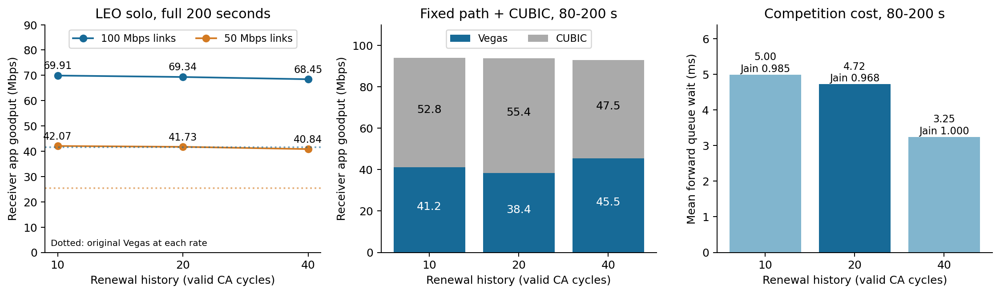

# Renewal timing sensitivity and assignment alignment

Owner: Jeongmin07. Follow-up on our PR15, dependent on PR14 v1 at
4a91c32cf90ea4aa6f81cc81accb2136e6e1f193. Declared before execution.
This is research evidence, not a change to the team's PLAN or a merge decision.

## Assignment boundaries checked against the original handout

The original `CS30401_26F_Lab1_Handout.pdf` was read on 2026-10-11.
Page 3 permits changing stations, satellites, link rates, queues, TCP, traffic,
and simulator code, with a stated basis for each value. Pages 4-5 require a
specific TCP mechanism, justified relevance, realistic information assumptions,
matched baselines, costs and limitations. Pages 6-7 require every reported
result to regenerate from code and README alone, in a fresh course environment.
Page 9 explicitly values explanation of marginal results.

This study changes only the existing endpoint renewal-history length and,
in a separately labeled capacity check, both link rates. No new model features,
TCP source change, route oracle, outage, random loss, or dependency is added.
The official pinned ns-3.48/Hypatia image and supplied 200-second Seoul-London
state remain the platform. Synthetic competition is a diagnostic control;
the actual problem and improvement must remain demonstrated in the LEO model.

## Different approaches assessed

| Perspective | Possible improvement | Evidence and decision |
| --- | --- | --- |
| Mechanism | Renew an obsolete delay reference sooner/later | Run a small, fully reported neighborhood around PR14's 20-cycle choice; no optimum claim. |
| Other users | Evaluate aggregate delivery, CUBIC share, fairness and actual queue delay | Retain fixed-propagation CUBIC control, where renewals reveal congestion absorption. |
| Network conditions | Change available capacity while holding policy fixed | Predeclare 50 Mbps, half the original 100 Mbps, to test BDP/response sensitivity; not a measured satellite capacity claim. |
| Alternative control law | Adapt Vegas alpha/beta | Already tested in PR15; lower LEO benefit and worse sharing. Do not repeat it. |
| Fresh delay measurement | Slow down to drain self-induced queues | Requires fresh RTT/probe state; CUBIC can refill queues. Defer the larger implementation rather than equating SRTT minima with empty-queue propagation. |
| Explicit network information | Route/queue notifications | Potentially separates causes but requires realistic delivery, accuracy and cost evaluation. No such signal is implemented. |
| Submission quality | Reproduce without Git metadata | Existing runner assumes Git. This is a final-package gap even though current research runs are reproducible from a clone. |

Literature: La, Walrand and Anantharam, *Issues in TCP Vegas*, UCB/ERL M99/3
(1999), Sections 3-4, establishes the stale-reference/persistent-congestion
problem and earlier renewal ideas: https://www2.eecs.berkeley.edu/Pubs/TechRpts/1999/ERL-99-3.pdf .
The fixed version of LEDBAT++ draft -06, Sections 3.3/4.4/4.5, discusses
measurement aging and slowdowns: https://datatracker.ietf.org/doc/html/draft-irtf-iccrg-ledbat-plus-plus-06 .
Neither is claimed to implement our exact ns-3 SRTT-based rule. Vegas is a
course implementation and an interpretable delay-based mechanism, not claimed
to be the dominant modern Internet TCP; the report must justify this scope.

## Predeclared matrix and interpretation

Ten runs, two workers, no automatic retries or parameter search:

1. `s1-leo-r10/r20/r40`: supplied LEO, 100 Mbps, q100, renewal enabled.
2. `s1-fixed-comp-r10/r20/r40`: fixed 90 ms propagation RTT, 100 Mbps,
   q100, Vegas at 0 s and CUBIC at 80 s; renewal enabled.
3. `s1-rate50-base/r10/r20/r40`: supplied LEO, 50 Mbps, q100,
   ordinary Vegas or renewal. All otherwise identical to item 1.

Rounds 10/40 halve/double the existing 20-valid-CA-cycle history. These are
cycle counts, not fixed wall-clock periods. The 1 ms rise threshold is held
constant; adaptive thresholds remain OFF. All cases last 200 s, bulk size
100 GB, seed 123456789, no pacing, MSS 1380, existing buffers/startup/loss rules.
Micro initial ssthresh remains 900 MSS; LEO retains its original settings.
100 Mbps baseline and adaptive results are reused only with their original
provenance; new r20 measurements must match the original PR14 measurements.

Primary metrics: full-200s receiver app goodput in LEO; both flow goodputs,
aggregate, Jain fairness, actual forward queue wait and drops in common
[80,200) competition. State traces check actual policy and renewal events.
The 50 Mbps comparisons use their own newly measured baseline. It is one
capacity sensitivity check, not an independent path or statistical sample.

Do not select a winner on Vegas throughput alone. A candidate dominates r20
here only if LEO goodput, competition aggregate and Jain are at least r20,
and competition mean queue delay is at most r20 (with at least one strict
improvement). Otherwise report the tradeoff and preserve the main candidate.
50 Mbps results are validation conditions, not a second optimization stage.
One representative new setting is replayed in the retained independently
built second volume. All raw results and manifests are preserved.

## Completed primary results (verified 2026-10-12)

All ten cases completed at source commit
`fbc0b2b01055e51ccfdd0ea33606301e8c9ae4b0`, using the unchanged PR15 full patch
`849ae664d01a0e084dfaaae764aff81c76333ae31c07c97eae0300cd56a0a0db`.
Adaptive thresholds were disabled in every case. The batch, including full
analysis with two workers, took 924.65 seconds (15.41 minutes) on this host.
The credit interruption affected a later status check, not the running batch.

| Renewal history | LEO 100 Mbps: app Mbps | LEO 50 Mbps: app Mbps |
| --- | ---: | ---: |
| Original Vegas | 41.5113384 (previous verified baseline) | 25.3262016 (new baseline) |
| 10 cycles | 69.9134496 | 42.0674784 |
| 20 cycles | 69.3432336 | 41.7340152 |
| 40 cycles | 68.4537960 | 40.8432528 |

| Fixed+CUBIC, common [80,200) | 10 cycles | 20 cycles | 40 cycles |
| --- | ---: | ---: | ---: |
| Vegas app Mbps | 41.170000 | 38.419844 | 45.450484 |
| CUBIC app Mbps | 52.760160 | 55.382896 | 47.468688 |
| Aggregate app Mbps | 93.930160 | 93.802740 | 92.919172 |
| Jain fairness | 0.985003 | 0.968333 | 0.999528 |
| Mean forward queue wait, ms | 4.995099 | 4.723997 | 3.247748 |
| TcDrop rows, all flows | 185 | 186 | 203 |
| Vegas retransmission rows | 10 | 6 | 5 |
| Renewals, whole 200 s | 47 | 28 | 8 |



The 10-cycle setting buys only 0.570216 Mbps more LEO throughput than r20,
while raising competition queue wait by 0.271102 ms. The 40-cycle setting
retains 98.72% of r20's LEO throughput, lowers competition queue wait by
31.25%, and brings sharing close to equal. Its cost is 0.883568 Mbps less
competition aggregate throughput and 17 additional TcDrop rows. Neither
candidate dominates r20 under the predeclared four-metric criterion.

**My assessment:** r40 is the more attractive *balanced* candidate when queue
delay and sharing matter; r20 remains the reference setting and r10 is the
slightly faster solo option. This changes the recommendation from simply
retaining PR14's exact 20-cycle setting to showing a measured tradeoff within
the same renewal design. It is not a universal optimum or a team decision.
r40 still improves LEO goodput by 64.90% at 100 Mbps and 61.27% at 50 Mbps
against the baseline at each capacity. The capacity check supports benefit
at these two rates, not generalization to unseen paths or traffic mixes.

## What the traces explain, and what remains uncertain

All three LEO histories renew three times. Around the 121.6-second route event,
r10/r20/r40 renew at 122.670948/123.587695/125.420566 s; around 187.4 s they
renew at 188.555983/189.548915/191.536329 s. Longer histories therefore delay
the reference adjustment. They also change the initial CA renewal:
1.298070/2.295799/4.197050 s, so the whole-run difference must not be attributed
entirely to the two later route changes.

On the fixed 90 ms path, first renewals occur at 91.020729/91.958451/131.141743 s.
The maximum renewed bases are 100.067816/99.452851/95.093086 ms. The longer
history filters more queue episodes in this case, consistent with its smaller
measured queue cost. But r40 still renews eight times without a propagation
change, so it has **not solved congestion/route discrimination**. The nonmonotonic
Vegas shares show why delay-history tuning cannot be interpreted as a simple
aggressiveness knob. The traces establish rule operation and total outcomes;
they do not isolate every downstream cause of the changed flow shares.

LEO retransmission counts are 71 for all three renewal histories at 100 Mbps,
and 34 at 50 Mbps (the new 50 Mbps baseline has 19). These are raw event counts,
not loss rates. LEO has no direct queue-wait measurement. The fixed two-node
control does not establish multi-hop LEO fairness. No statistical confidence
intervals are appropriate for these deterministic conditions.

The recent primary-author discussion in Lai et al., *Analysis for the Adverse
Effects of LEO Mobility on Internet Congestion Control*, Internet-Draft
`draft-lai-ccwg-lsncc-01` (February 2026), Sections 1/3/5, also frames stale
estimates and ambiguous endpoint signals as a current research problem:
https://www.ietf.org/archive/id/draft-lai-ccwg-lsncc-01.html . This is an expired
work-in-progress draft, not an RFC or evidence that our policy is validated
on real Starlink. Its terrestrial/PoP/probing assumptions differ from the course
ISL-only model. It motivates future detection work rather than importing those
assumptions into our experiments.

## Verification and reproducibility

[`verification.json`](../../code/vegas-adaptive/sensitivity-evidence/verification.json)
checks all ten declarations, original config hashes, raw analysis input hashes,
21,840 state rows and 101 renewal events. It reconstructs histories, eligibility,
minimum values, thresholds, resets, elapsed times and Vegas diff independently
of the main analyzer, reusing the pinned PR14 audit method with attribution.
Both r20 cases reproduce all **37** original PR14 measurement CSVs byte for
byte (wall-clock timing excluded), despite using PR15's patch with adaptation
disabled. This is compatibility evidence, not a new independent statistical trial.

The new portable package verifies a complete source-file hash inventory in
place of a host Git checkout. It keeps source commit attribution and still
checks the staged simulator patch and driver before execution. No simulation
policy was changed to make the package run. The package is intentionally a
research-code export: the final IEEE report, team author details and final
submission assembly remain separate work.

### Commands from a repository checkout

The original batch used the already built and pinned PR15 Docker container:

```powershell
docker exec lab1-vegas-adaptive-20261011 python3 /work/code/vegas-adaptive/run_sensitivity.py --image-digest sha256:3cb4877c73b4ae5e3542c1567b6761a8913056dd429d8a18f7c40aeeb399b3b4 --out /tmp/vegas-sensitivity/matrix.json
docker exec lab1-vegas-adaptive-20261011 python3 /work/code/vegas-adaptive/verify_sensitivity.py --out /tmp/sensitivity-evidence
docker exec -w /work/code/kim-study lab1-vegas-adaptive-20261011 uv run --frozen python /work/code/vegas-adaptive/plot_sensitivity.py --evidence /tmp/sensitivity-evidence --out /tmp/sensitivity-figures
```

Run from launch commit fbc0b2b for exact historical source provenance. The audit
and figure scripts were added after that commit; use them from the completed
branch without relabeling the earlier simulation source. New outputs are
required; existing case paths are deliberately refused. For a current-source
replay, pass its exact source commit to `verify_sensitivity.py
--expected-source-commit SHA`. The package README supplies complete fresh-volume
commands without any host Git metadata. The initial representative replay was
subsequently extended to the full ten-case workflow, as recorded below.

### Git-free replay and publication

The package source is `1deee988a37325c230a389ad4e6dafc518fc138f`, a later
commit adding source-inventory validation without changing simulator policy.
It was exported, zipped, extracted into a new directory with no `.git`, mounted
read-only at `/work`, and built in a **new** official ns-3 volume. No host Git
mount was provided. The README's forty-cycle fixed-competition run completed
in 47.88 seconds; its full raw-log analysis then passed.

[`portable-replay-verification.json`](../../code/vegas-adaptive/sensitivity-evidence/portable-replay-verification.json)
confirms all **26** measurement CSVs, all analyzed windows, the independent
2,200-row state audit, simulator sources, binary, shared libraries, patch,
image, policy and network settings match. The runner's source commit/hash
differs because packaging verification was added; this difference is explicit.
A negative test with an incorrect source hash exits nonzero before creating
a case directory. This was the initial representative replay; a later full
workflow check uses the same extracted package and fresh official volume.

### Complete package workflow check, 2026-10-12

After the publication interruption, the exact ZIP README matrix command ran
all ten cases at source `1deee988a37325c230a389ad4e6dafc518fc138f` in
1,044.65 seconds including analysis, with its declared two workers. The
unchanged package is mounted read-only, with no host Git metadata. The
separate original-Vegas 100 Mbps baseline ran concurrently and reproduced
41.5113384 Mbps. No simulation settings or TCP code changed for this check.

The README's independent audit and locked-dependency plotting commands both
passed. [`full-package-replay.json`](../../code/vegas-adaptive/sensitivity-evidence/full-package-replay.json)
records exact matches for all **155** matrix measurement CSVs, all **11**
baseline measurement CSVs, every analysis window, simulator identity, the
57-row result table and the figure PNG. The regenerated PDF is also produced;
its timestamp metadata is not required to match. The state audit again checks
21,840 rows and 101 renewals. The comparison script runs outside the package
and checks original archive inventories; it does not modify the tested code.

Compact new manifests, matrix and analyses are in `full-package-replay/` and
`full-package-baseline/`. Identical measurement contents remain available in
the original published archives; the replay raw files are also retained in
the Docker container. These are reproduction checks, not independent trials.
This closes the complete research-ZIP workflow gap. A final submission with
the report and any further selected results still needs its own clean check.

The source package contains no raw logs, state, ns-3 source tree or build
artifacts. Its README includes full-matrix and figure/table regeneration commands,
dependency setup using the existing uv lock, baseline-line provenance, model
limitations and attribution. It is a tested research-code package, **not**
`Lab1_5.zip` and not a complete final submission.

Evidence release: https://github.com/Jeongmin07/CS30401-Lab1/releases/tag/vegas-sensitivity-20261011 .
The tag pins the ten-case launch commit; the portable source ZIP embeds its own
later source commit. Primary raw archive: `vegas-sensitivity-20261011-raw.tar.gz`,
783,526,960 bytes, SHA256
`061f489e810fed62491bd38d2bed590112e35e108b36bc90bd8c01b283e7476f`.
All 277 selected files were independently streamed from the archive and checked
against their original sizes/SHA256. The archive includes all ten original run
trees, matrix receipt and full analyses; later replay/publication records are
separate. Package ZIP: `vegas-portable-20261012.zip`, 126,733 bytes, SHA256
`4203611ba5f6f72d411e7c86ccdae1d28bb3ca07ead5f8b985ae10c7b09a0a64`.
The separate fresh-replay archive and final server checks are identified by
the compact publication receipts next to these results.

## Next project action

My preferred balanced report candidate is **the same Vegas renewal design with
40 valid cycles**, retaining 20 cycles as the established reference and showing
all three settings. This is a sensitivity-based choice with an explicit
throughput/queue/sharing tradeoff, not a new control algorithm or a claim of
route identification. The demonstrated problem, pure-delay step control and
fixed-path counterexample remain the core argument from PR14; the CUBIC and
adaptive studies are useful rejected alternatives, not competing main stories.

The remaining highest-value work is the English IEEE report, figure/table
selection and final package assembly with confirmed team scope and author
names. Further parameter search on this one path would not establish broader
validity. No teammate branch, common PLAN or main merge was changed.
