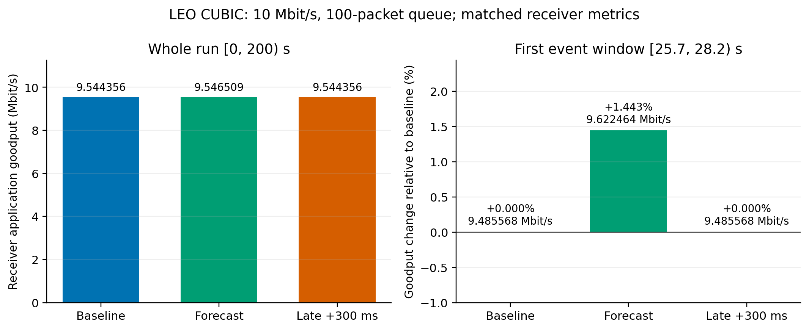
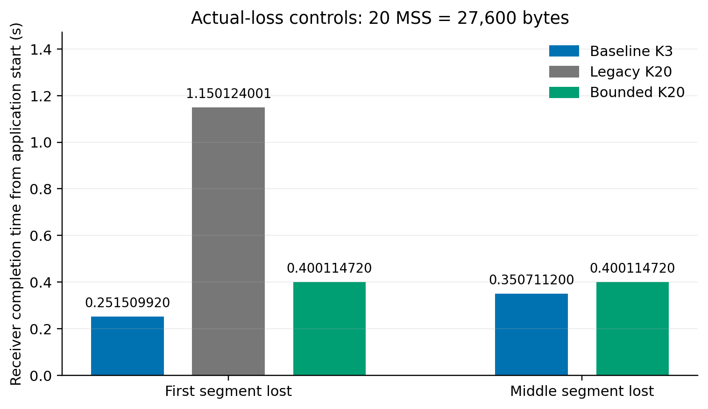

# 예측 경로 구간의 손실 판정과 제한된 복원

2026-10-12, kim-seongchan, [PR16](https://github.com/Jeongmin07/CS30401-Lab1/pull/16). 초기 commit `4a1441a`에서 실행 집합을 먼저 선언했고, 추가 경계 대조도 `0942d22`에서 실행 전에 선언했다. **총13개 실행·분석이 성공했으며 결과와 한계를 아래에 기록한다.** 송신 pause/pacing 후보를 우선 제외하고, 기존 K8/K20 정책을 재사용하면서 예측 구간 계산과 종료 시 손실 재평가를 검증했다. 큰 처리량 개선을 가정하지 않았다.

## 질문과 구현 범위

제공 CUBIC/SACK/PRR에서 경로 단축을 예고받아 일시적으로 손실 판정 문턱을 높이면 불필요한 복구를 줄일 수 있는가? 기존 정책의 복원 지연을 없애는 작은 변경으로 실제 손실의 긴 기다림을 줄일 수 있는가?

기존 K8/K20도 이미 전환 주변의 notified window 방식이었다. 이번에 새로 검증할 것은 **기하에서 선택한 전환/구간 + 구간 종료 시 threshold 복원과 기존 SACK/dupACK 증거 재평가**다. 송신 속도·CUBIC 성장식을 바꾸지 않으며, 알림의 정확성·진짜 손실·현재 복구 구현의 한계를 명시한다. 현대 Linux RACK 구현이나 동작 비교는 추가하지 않는다.

canonical v6 관측/benchmark를 새 공식 volume에 적용하고 추가 patch를 합쳐 하나의 `code/predict-loss/ns3.patch`로 내보낸다. opt-in `study_bounded_restore=1`일 때만 새 종료 처리를 사용하고 기본 off는 기존 v6 동작을 유지한다. CA_OPEN·dupACK 0·알려진 loss 없음·SACK on/FACK off에서만 보호 시작을 허용한다. RTO를 정지하지 않으며 종료 때 기존 손실 증거를 버리거나 가짜 ACK를 만들지 않는다. 구간이 끝났다고 단순히 K를 3으로 내리면 남은 dupACK 수로 assertion/손실 복구 누락이 생길 수 있어 core 재평가가 필요하다.

## 예측 정보와 미리 정한 규칙

- 입력은 기존 `code/kim-study/path_truth_200s.csv`의 공급 state 기하 정보다. 실행 결과의 패킷 시각을 정책 입력으로 쓰지 않는다. 공개 궤도만으로 실제 경로를 안다는 주장이 아니라, routing을 계획하는 운영자의 정확한 미래 힌트 조건이다.
- path_changed이고 전파 RTT가 감소하는 전환만 선택한다. 보호 시작은 전환 T, 기간 H는 `2×max(이전, 이후 전파 RTT)`로 정한다. 26.2초에서는 195.396ms다. 이는 큐를 포함한 최대 도착시간 보장이 아닌 **선언한 후보 규칙**이다.
- 문턱 20은 피드백과 기존 연구를 이어 보는 고정 진단값이다. 100Mbps에서는 기존 문턱64를 추가 대조로 미리 선언한다. 큰 문턱이 최적이거나 혼잡 반응을 보존한다는 가정은 하지 않는다.
- 정확한 시각과 300ms 늦은 알림을 비교한다. 운영자 메시지 전달 프로토콜은 구현하지 않는다. 구간 종료 후 안전하게 K3 복원이 실행됐는지 실제 이벤트로 확인한다.

## 선언한 실행 집합과 예산

1. stable micro: 100Mbps·q2000·편도50ms·4초·20MSS(27,600B). 첫 segment 실제 손실은 baseline/기존 window/new bounded를 비교하고, 중간 segment 실제 손실은 baseline/bounded를 비교한다. false hint 구간은 0.15–0.35초다. 총5개로 종료 재평가가 추가 ACK 없이 동작하는지, finite FCT/RTO 비용을 확인한다.
2. LEO: 10Mbps·q100·200초, 단일100GB CUBIC. baseline/정확한 forecast20/300ms late 세 개. 기존 고정 평가창 `[25.7,28.2)`, `[74.5,77.0)`과 전체 goodput·실제 수신량·복구/재전송·drop을 함께 본다. 새 baseline raw는 기존 v6 기록과 대조한다.
3. 위 두 검증이 정상 완료되면 100Mbps·q1000·40초 baseline/forecast20/forecast64 세 개만 확인한다. full 200초 결과로 부르지 않는다. 큐와 용량은 Guide 예제와 기존 high-rate study를 따른 출발점이며 실측 Starlink 값이 아니다.

실행은 하나씩, 각180초 wall cap이다. timeout/오류이면 batch를 중단하고 부분 결과는 성능 표에서 제외한다. 새로운 토폴로지나 대규모 sweep을 생성하지 않는다. 새 container `lab1-predict-loss-20261012`, volume `cs30401-predict-loss-ns3-20261012`, CPU4/6GiB. 이미지 digest는 이전 진단과 같은 공식 `sha256:3cb4877c73b4ae5e3542c1567b6761a8913056dd429d8a18f7c40aeeb399b3b4`다.

### 종료 타이머와 독립적인 복구의 추가 경계 확인

앞선5개 micro·LEO10 세 개를 정상 완료한 뒤, core 소스를 바꾸지 않고 두 개의 짧은 경계 대조를 추가 선언한다. stable micro의3MSS(4,140B) 첫 segment 실제 손실은 후속 SACK가 기본 문턱3에도 부족해 기존 타임아웃 경로를 탄다. baseline과 bounded를 비교하며 bounded에는 일부러 긴 false hint0.15–1.5초를 준다. 실제 구간 종료 전 CA_LOSS가 발생하면 threshold가 해제되는지, 기본 전송 완료 시간을 바꾸지 않는지 확인한다. 이것은 기하H 규칙의 새로운 성능 조건이나 성공 탐색이 아니라 **CA_LOSS-release 구현 경로를 확인하는 경계 대조**다. 타이머의 직접 로그 없이 일반 CA_LOSS를 모두 RTO라고 부르지 않는다.

## 평가와 중단

앱의 유일한 순서대로 전달된 바이트를 goodput으로 쓰고 sender ACK progress와 섞지 않는다. 재전송 감소 자체를 큰 처리량 개선으로 바꾸어 쓰지 않는다. finite flow는 전체27,600B 수신 후 FCT를 계산한다. 실제 손실 복구 지연·경계 종료·skip·RTO를 함께 확인한다.

Guide의 cwnd/SRTT 그래프는 PDF9쪽이며 10쪽 globe에도 Figure3 번호가 중복된다. 5.4초 그래프 모양만으로 경로 단축·재정렬·허위 복구를 입증할 수 없다. 확인된 26.2초 패킷 증거를 출발점으로 쓰며 가설을 만족하도록 전환·큐를 크게 바꾸지 않는다.

효과가 작으면 그 크기를 그대로 보고한다. epoch가 끝나도 high threshold가 남거나 실제 손실이 RTO까지 부당하게 지연되면 구현을 수정하고 검증 전 성과로 공유하지 않는다. 결과 원본·실행 commit·patch/runtime/input/output hash와 명령은 기록 후 PR에 공유한다.

## 실제 완료 결과

[13개 결과표](assets/20261012-forecast-loss/export/results.csv), [각 실행의 manifest·compact summary](assets/20261012-forecast-loss/export/cases/), [export receipt](assets/20261012-forecast-loss/export/export-receipt.json)를 확인한다. 원본 크기·SHA, 실제 앱 수신 합과 endpoint, 평가창 분모, setter의 실제 보호 기간을 검증했다. 전체 분석의 SHA와 생략한100ms bin/상세 사례 수는 각 summary에 있다. 같은 deterministic 설정의 비교이며 독립 seed 반복이나 통계적 신뢰구간은 없다.

### LEO: 복구 감소와 실제 전달량을 함께 본다

| 조건 | 전체 앱 goodput Mbit/s | 원본 대비 전체 변화 | `[25.7,28.2)` 앱 goodput | 첫 창 재전송/복구 |
| --- | ---: | ---: | ---: | ---: |
| 10Mbps/q100/200초 원본 | 9.5443560 | — | 9.485568 | 3 / 1 |
| 같은 조건 forecast20 | 9.5465088 | +0.0226% | 9.622464 | 0 / 0 |
| 같은 조건 late300ms | 9.5443560 | 0% | 9.485568 | 3 / 1 |
| 100Mbps/q1000/40초 원본 | 94.501572 | — | 96.092160 | 32 / 1 |
| 같은 조건 forecast20 | 94.506264 | +0.0050% | 96.167232 | 15 / 1 |
| 같은 조건 forecast64 | 94.510404 | +0.0093% | 96.233472 | 0 / 0 |

10Mbps 첫 평가창의 전달량은 +1.4432%였지만 전체200초 이득은 약0.023%로 작다. 후기75초 창에서는 원본9.626880 대비 forecast9.618048Mbit/s로 조금 낮고, forecast에는12재전송/2복구가 있었다. 첫 개입 이후 궤적이 달라졌으므로 이를75초 보호만의 독립 비용으로 단정하지 않는다. 큰 이득을 주장하기 위해 첫 창만 선택하지 않는다.

100Mbps에서는 첫 창에34개의 out-of-order payload가 있어 문턱20으로 불필요한 복구가 남았다.64는 그 창의 복구를 제거했지만 전체40초 이득은 약0.009%다. 전체 drop/복구 궤적도 바뀌었다. 이것은 full200초·현대 Linux·임의의 트래픽에 대한 개선 주장이 아니다. 피드백의 "10–20이면100Mbps를 유지해 극적인 개선"은 이 결과로 뒷받침되지 않는다.

실제 high-threshold 기간은10Mbps의 두 전환에서195.396ms와181.974ms, 합계377.370ms였다.100Mbps에서는 첫195.396ms만 적용했다. 모든 적용은 선언한 종료 시각에 K3로 복원됐다. late는 같은 기간을300ms 이동시켰고 원본과 동일한 전달량·재전송/복구 결과를 보였다.

### 실제 손실: 기존 보호의 복원 지연을 줄이지만 원본보다 느리다

| stable micro·실제 손실 | 원본 FCT 초 | 기존 K20 FCT 초 | 새 bounded K20 FCT 초 |
| --- | ---: | ---: | ---: |
| 20MSS 첫 segment | 0.251509920 | 1.150124001 | 0.400114720 |
| 20MSS 중간 segment | 0.350711200 | 미실행 | 0.400114720 |
| 3MSS 첫 segment·긴 false hint | 1.150124001 | 미실행 | 1.150124001 |

20MSS 모든 조건은27,600B를 완전히 수신했고 정확히1개의 tagged actual drop과1개의 재전송을 기록했다. 첫 손실에서 기존 보호는 종료0.35초를 지나1.100009281초까지 K20을 유지했다. 새 보호는0.35초에 K3로 복원하고 **추가 ACK 없이 기존 손실 증거로 복구에 진입**했다. 실제 보호 기간은 기존950.009281ms 대비 새200ms다. 첫 FCT는 기존 대비 약65.2% 줄지만 원본보다148.6048ms 느리다. 중간 손실도 원본보다49.40352ms 느리다. 즉 실제 손실 비용을 줄였으나 제거하지 못했다.

3MSS 대조에서는 두 조건 모두4,140B를 완전히 전달했다. bounded는 CA_LOSS trace 뒤1.100009281초에 K3로 해제됐고 원본과 같은 FCT였다. 기본 복구 타이머의 본문은 수정하지 않았다. 일반적인 CA_LOSS를 직접 타이머 계측 없이 모두 RTO로 부르는 결론은 피한다.

### 소스·원본·검증 범위

- combined patch SHA256: `666c376fe68687f053786d850af926402f59f925c9b7706c72faec6e50b42340`. canonical v6 위의 추가 구현을 포함한 한 장이며 설치 도구·core 소스 검토·4-job 빌드를 통과했다.
- [실제 환경](assets/20261012-forecast-loss/environment.json)은 공식 이미지 digest·CPU4·6GiB·새 volume을 확인한 Docker inspect다. 각 실행의 manifest는 실행 당시 runner/commit·실제 설치 diff·binary/library·설정/명령·입력/출력 hash를 보존한다. source 파일 hash가 해당 commit의 Git blob과 일치함도 확인했다. `repo_dirty=true`를 숨기지 않으며 실행 필수 파일은 별도로 식별했다.
- [기존 원본과의 비교](assets/20261012-forecast-loss/historical-equivalence.json): LEO10 baseline과 finite 첫/중간 baseline 세 조건의 원본8개씩, 총24개 CSV가 기존 v6 결과와 byte-identical이다. default off의 이 조건들에 대한 검증이며 전 조건의 무영향 증명이 아니다.
- [그림 receipt](assets/20261012-forecast-loss/figures/plot-receipt.json)는 작은 summary8개·full-analysis hash·표시 값·PNG/PDF4개의 SHA를 연결한다. 실제 숫자와 시각적 잘림/겹침을 확인했다. Git의13-case export와 모든 그림 입력이 같은 바이트임도 검증했다.
- simulation wall time 합계는271.3979초다. 빌드·분석·자료 공유 시간은 제외했고 연속 batch 전체 경과 시간이나 독립 반복 횟수로 쓰지 않는다. 모든13개가180초 개별 cap 안에 성공했다.
- 원본 압축은85,141,440B, 텍스트205개, 미압축529,509,233B다. SHA256 `3d55c45297446dbdf601bdbfe9485a9e1ed7c6098d8306778dd9c6991fd7c3d1`. [inventory](assets/20261012-forecast-loss/raw-inventory.json)의 모든 member size/SHA를 실제 archive와 대조했다. [GitHub diagnostic prerelease](https://github.com/Jeongmin07/CS30401-Lab1/releases/tag/forecast-loss-20261012)의 [압축 원본](https://github.com/Jeongmin07/CS30401-Lab1/releases/download/forecast-loss-20261012/forecast-loss-20261012.tar.gz)을 공유했고 GitHub asset digest/size도 일치했다. build/state는 포함하지 않는다. release target은 공유 commit이며 실제 실행 commit은 각 manifest를 따른다.
- [새 빈 volume의 별도 재현](assets/20261012-forecast-loss/clean-replay.json): combined patch 한 장을 원본 공식 source에 적용해 빌드하고, `loss-first-bounded`와 `leo10-forecast` **두 조건만** 다시 실행했다. 측정CSV19개와 schedule1개, 설정·상태 입력·모든 실행 binary/library가 원본과 일치했다. wall-clock profiling `timing_results.csv` 한 개는 서로 다르고 양쪽 SHA를 보존했다. 전체13개나 분석/그림을 다시 재현한 주장은 하지 않는다. 별도 빌드33.06초·두 실행 약17.77초이며 앞의271.3979초와 구분한다.

## 이번 단계의 판단

예측 구간의 손실 판정이 확인된 episode를 완화한다는 근거와, 그 보호가 진짜 손실을 늦춘다는 비용을 함께 확보했다. 새 bounded 복원은 기존 보호의 긴 기다림을 줄이는 실질적인 변경이지만, **큰 LEO 처리량 개선이나 원본보다 빠른 모든 손실 복구를 달성한 것은 아니다.** 마감 전에는 sweep을 확대하기보다 이 제한된 결론·필요 정보·대조와 재현 근거를 보고서와 팀 검토에 정확히 전달한다.
