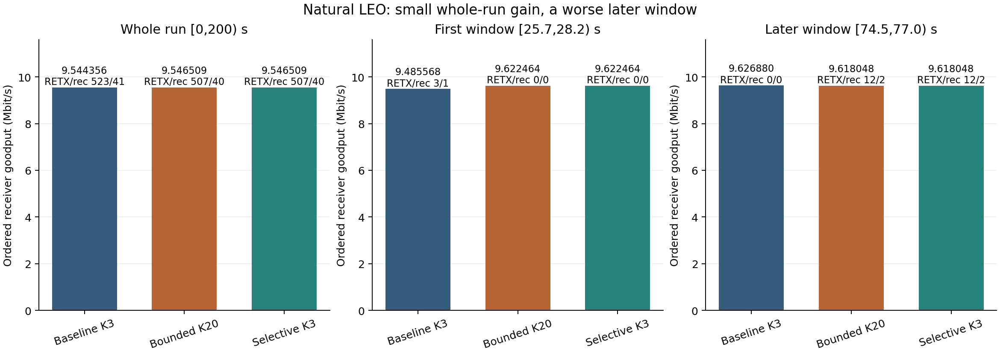
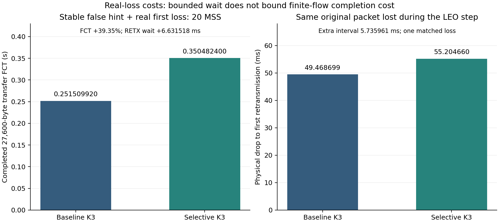

# 선택적인 짧은 SACK 손실 대기

2026-10-12, kim-seongchan. 아래 질문·규칙·집합은 실행 전 선언이며, 뒤의 완료 결과는 별도로 추가했다. 사용자가 승인한 세 후보 중 세 번째이며, 별도 공식 ns-3 volume에서 개발·실행했다. 기본 CUBIC/SACK/PRR의 손실 문턱 K3와 RTO를 유지한다.

## 질문과 최소 구현

확인된 26.2초 허위 복구를 줄이되, 기존 bounded K20보다 실제 손실의 추가 대기를 줄일 수 있는가? 경로 전환 T에 송신자가 아직 확인받지 못한 sequence 범위를 등록한다. 등록 당시 송신된 원본이고 lastSent≤T인 범위만 잠재적인 old-flight 대상으로 취급한다. 이는 실제 패킷의 남은 경로를 안다는 뜻이 아니다.

첫 소스 검토에서 head만 보호하려 했으나, 기존 26.2초 증거의 SACK가 head를 포함한 세 old-flight hole을 함께 손실로 표시함을 확인했다. 뒤에서 head로 순회하는 구현에서 나머지 두 hole을 먼저 표시하면 head 보호는 시작할 수 없다. **첫 시뮬레이션 전 이 구조를 수정해, 동일 old-flight cohort의 eligible holes를 하나의 episode deadline으로 보호한다.** 기본 SACK 정보·delivered accounting은 계속 갱신하고 손실 표시 직전에 처음 의심된 eligible hole부터 짧은 deadline을 부여한다. 다른 eligible head로 이동하거나 후속 SACK가 와도 deadline을 연장하지 않는다. cohort 밖 패킷의 기본 K3 손실 표시나 ECN/기존 recovery/RTO가 발생하면 보호를 해제하고 기본 복구로 돌아간다. 이미 표시된 loss를 지우거나 PRR의 pipe 값을 가짜로 줄이지 않는다. 등록과 대기는 소켓별로 독립적이다.

등록 유효기간은 기존 비교와 같은 식 T~T+2×max(old,new propagation RTT)으로 계산한다. 값까지 동일한 것은 아니다. 같은 T에서 방향별 경로를 계산한 selective는 26.2초에서195390816ns, 75초에서181977820ns이고, 기존100ms 간격의 반올림 RTT를 사용한 bounded20은 각각195396000ns와181974000ns다. 5.184µs·3.820µs 차이는 실행 전에 고정됐다. 실제 대기는 첫 손실 의심 시각부터 `τ=clamp(2×forward propagation decrease,1ms,20ms)`이며 등록 종료를 넘기지 않는다. 대상 수신을 확인하는 ACK/SACK 또는 deadline에서 보호를 해제하고 기존 증거를 재평가한다. 추가 ACK 없이 stock recovery에 진입할 수 있도록 기존 bounded 복원의 원칙을 재사용한다.

## 예측 입력과 고정 규칙

입력은 [방향별 기하](../../code/orbit-geometry/forward-hints.csv)다. old/new 경로를 같은 T에서 계산하고, forward가 바뀌며 편도 전파 지연이 **1ms 이상 감소한 두 전환(26.2/75초)**만 선택한다. 미래 패킷 trace나 FCT를 입력으로 쓰지 않는다. 운영자가 정확한 routing·전환 시각을 알려 주는 oracle 조건이고 메시지 전달·시각 오차는 구현하지 않는다.

SACK 규모 예산은 `3+ceil(Rbit/s×forward_drop_s/(8×MSSbytes))`다. R은 해당 조건에 미리 선언한 링크 속도이며 실제 순간 송신률이나 정확한 추월 상한으로 부르지 않는다. 이 예산을 넘으면 대기를 끝내고 기본 K3 표시/복구를 허용한다. CUBIC은 현재 pacing이 꺼져 있고 큐·burst·역방향 ACK 전달은 이 기하 예산만으로 예측되지 않는다.

## 사전 실행 집합과 중단

최종 성능 표는 동일 V2 source/runtime의7조건이며 각240초 wall cap이다. 아래 peer review 보수 전에 이미 완료한 V1 micro2는 예비 자료로 보존하며 최종 표와 합산하지 않는다. 전체9attempt(예비2+최종7) 범위다. 짧은 micro를 먼저 검증한다. 기본 문턱 유지, 실제 타이머·SACK/dupACK invariant·pipe accounting과 종료 시 복구를 확인하지 못하면 긴 실행을 시작하지 않는다.

1. stable micro 100Mbps·q2000·편도50→50ms·4초·20MSS(27,600B)의 첫 segment 실제 손실: baseline/새 selective 두 조건. 정책에는 일부러 0.15~0.35초의 잘못된 positive hint와 26.2초와 같은 forward 감소 예산을 준다. Δ=0을 알아 보호를 생략하는 방식으로 안전 비용을 숨기지 않는다.
2. 제공 LEO 10Mbps·q100·200초 단일100GB: baseline/기존 bounded K20/새 selective 세 조건. 전체와 `[25.7,28.2)`, `[74.5,77.0)`의 앱 고유 수신량·재전송/복구/실제 drop과 정책 이벤트를 비교한다.
3. 같은 LEO 경로 단축 중 원본 old-flight의 실제 tagged drop을 정확히 하나 주는 baseline/selective 두 조건. 대상 선택은 T·원본 송신 시각·flow/sequence 조건으로 실행 전에 고정하며 미래 실행 결과로 좋은 패킷을 고르지 않는다. 주입 규칙과 실제 선택된 tag를 모두 기록한다.

cohort 밖 hole의 기본 손실 표시가 보호를 해제할 수 있다. 그런 경우 작동하지 않은 범위와 실제 효과를 그대로 보고하며 결과에 맞춰 hole 범위·τ·예산을 확대하지 않는다. 실패/timeout/소스 불일치는 보존하고 성능 표에서 제외한다. 큰 처리량 이득이나 모든 실제 손실의 추가 대기0을 가정하지 않는다.

## 실행·재현 계획

새 container `lab1-orbit-loss-20261012`, 새 volume `cs30401-orbit-loss-ns3-20261012`, CPU2·4GiB, build1job. 공식 이미지 digest는 `sha256:3cb4877c73b4ae5e3542c1567b6761a8913056dd429d8a18f7c40aeeb399b3b4`다. 다른 후보나 기존 predict-loss volume은 수정하지 않는다. combined patch·실행 commit/dirty flag·runtime/input/output SHA·상태·명령과 실제 app delivery/FCT/정책 대기·복구 비용을 남긴다. 대용량 원본은 별도 압축과 member hash를 보존하고 작은 evidence만 Git에 둔다. 통계적 반복이나 현대 Linux RACK 구현의 성과로 일반화하지 않는다.

### 긴 실행 전 peer review 보수

V1 micro 두 조건은 `e8cea96`의 source에서 완전히 수신·한 실제 drop·한 재전송을 확인했다. shared wait는 정확6.631518ms였으나 FCT는0.251509920→0.350482400초였다. 짧은 재전송 지연도 PRR/ACK 시점을 바꾸어 남은 새 데이터의 전송을 다음 RTT까지 늦출 수 있다. 이 결과를 본 뒤 τ·packet budget을 튜닝하지 않았다.

별도 소스 검토에서 cumulative ACK 뒤 상태가 OPEN으로 돌아간 경우 deadline의 loss flag 재평가만 하고 송신을 깨우지 않을 가능성을 발견했다. 이는 관측된 실행 실패가 아니라 정확성 경계다. V2는 deadline과 registration End가 공통 재평가를 사용한다. OPEN에서는 **실제 저장된 head loss flag**가 있을 때만 DISORDER를 거쳐 기본 `EnterRecovery(0)`/`SendPendingData`로 진행한다. 가짜 ACK·dupACK count·cwnd 값을 만들지 않는다. DISORDER의 기본 증거 재평가와 RTO는 유지한다. registration End가 같은 시각의 deadline timer보다 먼저 실행돼도 대기를 넘기지 않는다.

V1 patch/readiness/micro 원본·예비 요약을 보존하고, 별도 V2 patch/readiness/source checkpoint에서 최종7조건을 실행한다. 이 보수는 새 성능에 맞춘 규칙 변경이 아니다. 해당 OPEN 분기가 실제 실행에서 나타나지 않으면 실행 검증된 경계라고 부르지 않는다. 공식 build의 `NS3_ASSERT=OFF`도 기록하며 단순 실행 성공을 디버그 assertion 검증으로 쓰지 않는다.

## 완료 결과: 최종 V2의 고정된 7조건

최종7조건은 모두 성공했고 동일한 V2 combined patch와 실행 바이너리·공유 라이브러리 hash를 사용했다. 실행 source checkpoint는 `730ea20936dd668c914c3ad3689231104134b592`다. 예비 V1 micro2까지 이 트랙은9회이며 통계적 반복9회라는 뜻이 아니다. 세 후보의 공통 passive 성공1회·timeout1회를 포함한 전체11attempt 집계는 [공통 기록](20261012-three-followups.md)을 따른다.

앱 goodput은 receiver의 ordered unique delivery bytes×8/선언된 구간 길이다. RETX는 공식 송신 재전송 trace, recovery는 상태 진입 횟수이며 distinct drops는 같은 tagged transmission의 중복 hook을 합친 값이다. LEO100GB bulk는200초에 미완료이므로 FCT를 보고하지 않는다. OPEN 보수 분기의 실제 이벤트는 최종7조건 모두0이다. 소스 검토·관측 accounting과 실행 성공을 모든 ACK 순서나 debug assertion의 검증으로 부르지 않는다.

### 자연 LEO: 첫 허위 복구는 줄였지만 전체 이득은 작다

| 조건 | 200초 앱 bytes | 전체 Mbps | RETX / recovery | distinct drops |
|---|---:|---:|---:|---:|
| baseline K3 | 238608900 | 9.5443560 | 523 / 41 | 499 |
| bounded K20 | 238662720 | 9.5465088 | 507 / 40 | 486 |
| selective K3 | 238662720 | 9.5465088 | 507 / 40 | 486 |

두 정책의 전체 앱 이득은53,820B, **+0.022556%**다. 확인된26.2초 episode에서는 세 old-flight hole을 같은 deadline으로 기다렸다. 실제 wait는26.328788841~26.334460816초(**5.671975ms**)이며 cumulative ACK가 cohort 밖으로 이동해6.631518ms deadline 전에 해제됐다. 실제 K는3을 유지했다.

| 정확한 receiver 구간 | baseline Mbps (RETX / recovery) | bounded20·selective Mbps (RETX / recovery) | 앱 goodput 변화 |
|---|---:|---:|---:|
| `[25.7,28.2)` 2.5초 | 9.485568 (3 / 1) | 9.622464 (0 / 0) | +1.443203% |
| `[74.5,77.0)` 2.5초 | 9.626880 (0 / 0) | 9.618048 (12 / 2) | −0.091743% |

**75초 구간에서는 두 정책 모두 baseline보다 나쁘고 selective wait 이벤트는0이다.** 앞선 개입으로 이후 흐름 궤적이 달라진 결과이므로 이를75초의 selective 대기 자체의 단독 효과로 해석하지 않는다. 전체 RETX 감소분을 모두 독립적으로 증명한 허위 재전송이라고 분류하지 않는다. sender SRTT의 양수 구간 시간 가중 평균은148.134825→151.189451ms이며, SRTT는 실제 편도 전파 지연이나 분리된 큐 지연이 아니다.

bounded20과 selective는 앱·wire Rx·cwnd·SRTT·progress·drop·coverage·flow의 **8개 원본 measurement CSV가 byte-identical**하다. packet CSV는 threshold 열만, 상태 CSV는 threshold 열과 정책 setter/expiry 이벤트만 제외한 전체 정규화 행이 각각 일치했다. policy trace와 실제 threshold 설정은 서로 다르며 wall profiling 파일도 동등성 범위에서 제외했다. [비교 영수증](assets/20261012-orbit-loss/comparison.json)에 모든 hash·행 수·제외 열을 남겼다.

### 실제 손실: 짧은 대기의 회복·유한 흐름 비용

안정된 micro의 잘못된 positive hint에서는 두 조건 모두27,600B 수신 완료·실제 drop1·RETX1·recovery1·CA_LOSS0이었다. FCT는 **0.251509920→0.350482400초(+39.351323%)**다. 첫 RETX는0.200477440→0.207108958초로6.631518ms 늦었다. deadline은 후속 SACK로 연장되지 않았지만 마지막 새 segment의 송신은0.201165760→0.300367680초로 늦었다. 짧은 손실 대기가 PRR/ACK 타이밍을 바꿔 남은 새 데이터 전송을 다음 RTT까지 미룰 수 있음을 보여 주며, **대기 상한이 FCT 비용의 상한은 아니다.** 예전 bounded20의0.400114720초는 과거 참고값일 뿐 이번 V2의 새 micro 세 번째 arm이 아니다.

LEO 실제 손실 pair에서는 같은 원본 packet을 같은 receiver 시각에 떨어뜨렸음을 flow0·tx_id21820·TX26.152017749초·seq29681041·payload1380B·node1585/device1·PhyRxDrop26.235726816초로 교차 검증했다. 선택 전 RETX는 양쪽 모두 없었다. drop 이후 첫 RETX까지는 **49.468699→55.204660ms**이며 **추가5.735961ms**는 이 한 matched case의 추가 비용이다. 전체 회복 시간이나 모든 손실의 보장 상한이 아니다. selective는 SACK 규모8이 예산7을 넘어 deadline보다 먼저 기본 복구로 돌아갔다. 전체 수신량은238604760→238606140B로1MSS 차이(+0.000578%)이며 대규모 이득은 없다. RETX522→521, recovery41→41, distinct drops500→500이다.

## 증거·재현과 해석 범위

[최종 작은 요약](assets/20261012-orbit-loss/final/results.csv)과 case별 `summary.json`, manifest, config, schedule, policy·주입 trace는 [final/](assets/20261012-orbit-loss/final/)에 있다. [최종 micro 감사](assets/20261012-orbit-loss/final-micro-audit.json), [예비 V1](assets/20261012-orbit-loss/micro-v1/), [그림 입력·출력 hash](assets/20261012-orbit-loss/figures/receipt.json)를 보존했다. 기존 기본 조건과의 원본 동등성도 micro9개·LEO baseline10개·bounded20 10개 measurement CSV에서 확인했다. wall profiling은 제외했다.

combined V2 patch SHA256은 `531bf802984af821afd928fb3932912aca383fcdec5771f30f78d75a806d5591`, [readiness](../../code/orbit-loss/build-ready-v2.json) SHA256은 `01c76e4b3856eb33825c835ac831f256a43f286db47e14f327c81aba4093291a`다. V1 patch SHA256은 `feb35824112dcc2031477dbb32c2002e4b548e3a30c3d3dde3d9f85d2eab9e1d`로 별도 보존했다. 실행 후 분석은 실제 physical drop identity와 receiver 시각을 엄격히 join하고 drop 전 RETX를 따로 분리하도록 강화했다. 실행 당시 helper와 source/dirty 상태를 manifest에 그대로 남기며 후속 helper hash로 바꿔 쓰지 않았다. 완료7조건의 simulation wall 합은238.721439초로 build·hash·analysis·archive 시간을 제외한다.

| 원본 archive | bytes | SHA256 | 검증 member 수 |
|---|---:|---|---:|
| `orbit-loss-v1-20261012.tar.gz` | 18021 | `ba8f232d78e7ad5754a3db208ebd01fb5c80ea2709c1e748ba60474e82d8f0d0` | 27 |
| `orbit-loss-v2-20261012.tar.gz` | 50724218 | `8d1a13d1eefc2f60c0d013276a8587828348c34dad586a36987e358d2587fccc` | 128 |

archive의 모든 member를 재개봉 stream hash/size로 확인하고 로컬 보관 사본까지 같은 hash를 확인했다. [V1 inventory](assets/20261012-orbit-loss/raw-inventory-v1.json)와 [V2 inventory](assets/20261012-orbit-loss/raw-inventory-v2.json)에 명세가 있다. 원본은 공통 [orbit-followups-20261012 Release](https://github.com/Jeongmin07/CS30401-Lab1/releases/tag/orbit-followups-20261012)에 게시됐으며, root가 GitHub bytes/digest를 로컬 archive와 확인했다. [공통 게시 영수증](assets/20261012-three-followups/release.json)이 게시 사실과 원격 검증의 기준이다.

이 결과는 제공한 단일10Mbps LEO 경로와 두 deterministic 실제 손실 대조의 제한적인 평가다. τ와 예산은 정확한 추월 상한의 증명이 아니며 이 실행만으로 운영 배포값이 검증된 것도 아니다. 경쟁 flow·예측 오차·추가 seed 반복·최종 binary의 별도 fresh-volume replay·현대 Linux RACK/TLP는 평가하지 않았다. 기존의 입증된 첫 허위 복구는 피했지만, 전체 이득은 작고 later-window 및 유한 흐름 비용이 남는다.
